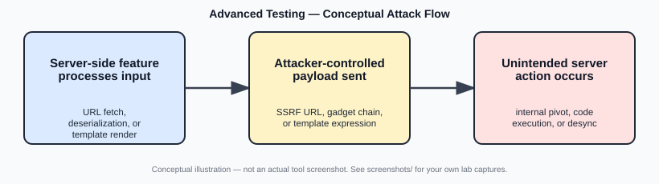

# 39. Server-Side Template Injection Testing

**Tier:** Advanced | **Category:** Advanced Testing

## 1. Project Overview and Objectives
Detect and exploit SSTI where user input is rendered inside a server-side template engine.

**Category context:** Complex, chainable, or infrastructure-adjacent vulnerability classes.

**OWASP reference area:** Advanced Testing

## 2. Lab Environment and Setup
- **Target application:** OWASP Juice Shop / DVWA / WebGoat (specify which instance you used for this run)
- **Attacker host:** Kali Linux (VM or Docker)
- **Network:** Isolated lab network / host-only VM network — never run these steps against a system you do not own or have written authorization to test
- **Setup steps:**
  1. Deploy the target app (e.g., `docker run -p 3000:3000 bkimminich/juice-shop`).
  2. Confirm the attacker host can reach the target (`ping`, browser check).
  3. Configure Burp Suite as the intercepting proxy (127.0.0.1:8080) and install the CA cert in the test browser.
  4. Take a clean baseline screenshot of the target's home page before testing begins.

> 📸 **Screenshot placeholder:** `screenshots/01-lab-setup.png` — target app running + Burp proxy configured

## 3. Tools and Commands Used
- **Primary tools:** Burp Suite, tplmap
- **Key commands/payloads used in this project:**
```
Read-only evaluation PoC on lab app; no OS command execution attempted.
```

## 4. Step-by-Step Testing Walkthrough



*The diagram above is a conceptual illustration of this category's attack pattern — not an actual screenshot. It shows the general shape of the attack (request → payload → result) that this specific project follows; the concrete steps for this project are below.*

1. Submit template syntax probes (`{{7*7}}`, `${7*7}`) into input fields.
2. Observe whether the expression evaluates (`49`) rather than reflecting literally.
3. Identify the template engine from error messages/behavior and escalate to a read-only PoC.
4. Document the injectable field and engine identified.

> 📸 **Screenshot placeholder:** `screenshots/02-request-capture.png` — relevant request/response captured in Burp
> 📸 **Screenshot placeholder:** `screenshots/03-exploitation-step.png` — payload submission / tool output
> 📸 **Screenshot placeholder:** `screenshots/04-result-confirmation.png` — confirmed result (clearly labeled if simulated/sanitized)

## 5. Interpretation and Technical Analysis
Explain here, in your own words after running the lab, *why* the behavior you observed occurred (e.g., missing server-side validation, trust in client-supplied data, weak randomness, missing header). Tie it back to the root cause, not just the symptom.

## 6. Findings
| ID | Finding | Severity | Risk | Impact |
|----|---------|----------|------|--------|
| F-01 | *(fill in after testing)* | Critical / High / Medium / Low / Info | *(likelihood × impact reasoning)* | *(confidentiality/integrity/availability affected)* |

## 7. Remediation Recommendations
- *(Fill in specific, actionable fixes — e.g., parameterized queries, output encoding, server-side authorization checks, regenerate session on login, enforce Origin validation.)*
- Reference the relevant OWASP Cheat Sheet for this category where applicable.

## 8. Final Penetration Testing Report Summary
**Executive summary:** *(1-2 sentence plain-language summary of what was found and overall risk to the business.)*
**Technical summary:** *(1 paragraph technical recap of the vulnerability chain and evidence.)*
**Retest recommendation:** *(what to verify once remediation is applied.)*

---
*Part of the [50 Web Application Penetration Testing Projects](../../README.md) collection. Testing performed only against intentionally vulnerable lab applications (OWASP Juice Shop, DVWA, WebGoat) under the author's own control.*
