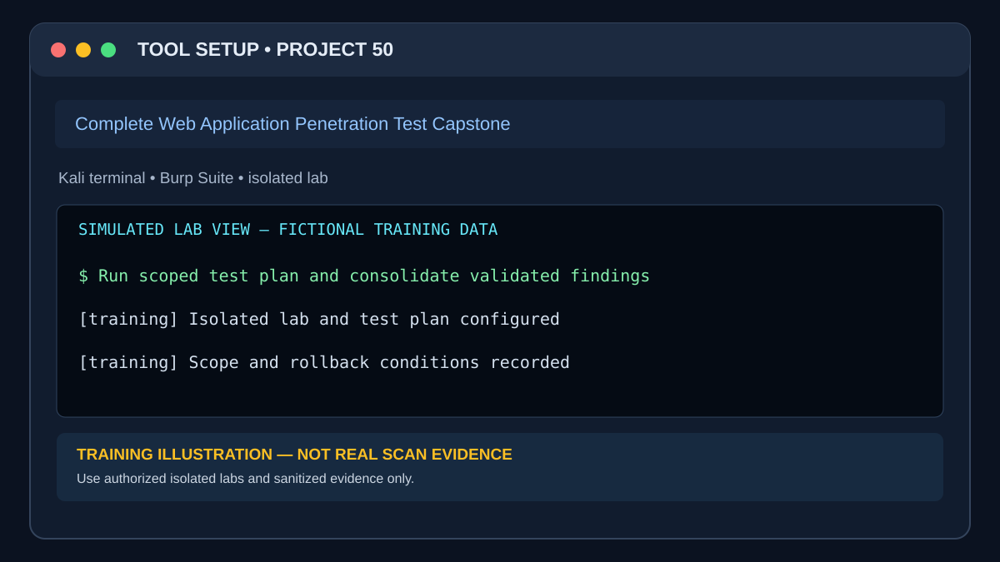
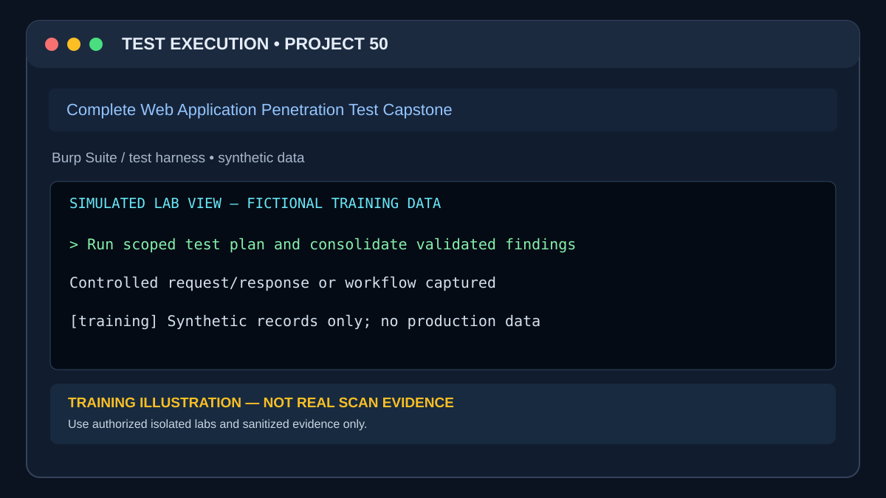
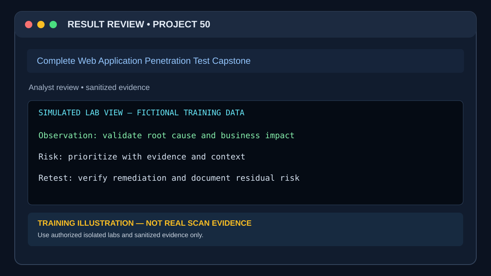

# 50. Complete Web Application Penetration Test Capstone

**Tier:** Advanced  
**Lab:** Juice Shop plus crAPI or custom multi-component lab  
**Tools:** Burp Suite, ZAP, Nmap, ffuf, sqlmap, Postman, browser DevTools

## 1. Objective
Conduct a controlled assessment of complete web application penetration test capstone and understand the security boundary, prerequisites, and impact. Advanced projects require a dedicated lab and careful rules of engagement.

## 2. Lab setup and rules of engagement
Build the target only in an isolated training network. Use mock internal services, synthetic records, disposable accounts, and local callback endpoints where required. Record exact in-scope hosts and ports. Do not probe real internal networks, cloud metadata services, or third-party infrastructure.

## 3. Baseline and architecture
Document the normal workflow and relevant components before testing. Capture baseline requests, responses, application logs, and version information. Identify trust boundaries and expected authorization behavior.

## 4. Step-by-step walkthrough

### Step 1

Define written scope, test accounts, exclusions, rate limits, and rules of engagement

### Step 2

Perform reconnaissance, technology discovery, endpoint mapping, and configuration review

### Step 3

Assess authentication, sessions, authorization, input handling, injection, uploads, and API controls

### Step 4

Test business logic and selected advanced cases within lab boundaries

### Step 5

Validate findings, assign severity, preserve redacted evidence, remediate, and retest

### Step 6

Produce executive summary, scope, methodology, findings, evidence, remediation, and retest results

## 5. Screenshots and evidence
These embedded images are simulated training illustrations, not real test evidence. Replace them with your own redacted captures from the authorized lab.

Preserve minimal reproducible requests, responses, timestamps, relevant logs, and test account roles. Redact secrets and personal information. Never publish live tokens, keys, customer records, or internal production details.

## 6. Technical analysis and expected output
Validate each observation manually. Explain root cause, trust boundary crossed, prerequisites, affected components, and demonstrated confidentiality, integrity, or availability impact. Document negative tests, false-positive checks, and limitations. A theoretical attack path is not a confirmed finding.

## 7. Findings, remediation, and retest
Use a consistent finding format: title, severity rationale, affected component, description, evidence, impact, reproduction, root cause, remediation, and retest result. Recommend architectural fixes where needed and verify that the fix closes the attack path without breaking legitimate behavior.

## 8. References
- [OWASP Web Security Testing Guide](https://owasp.org/www-project-web-security-testing-guide/)
- [OWASP Cheat Sheet Series](https://cheatsheetseries.owasp.org/)
- [PortSwigger Web Security Academy](https://portswigger.net/web-security)

**Safety:** Authorized isolated training environments only. Do not run advanced tests against systems without explicit written permission.

## Project-specific simulated tool screenshots

> Fictional training illustrations of setup, test execution, and analyst review—not genuine captures, actual scan output, or proof of a vulnerability. Reproduce the workflow in an authorized lab and replace these examples with your own redacted evidence.

