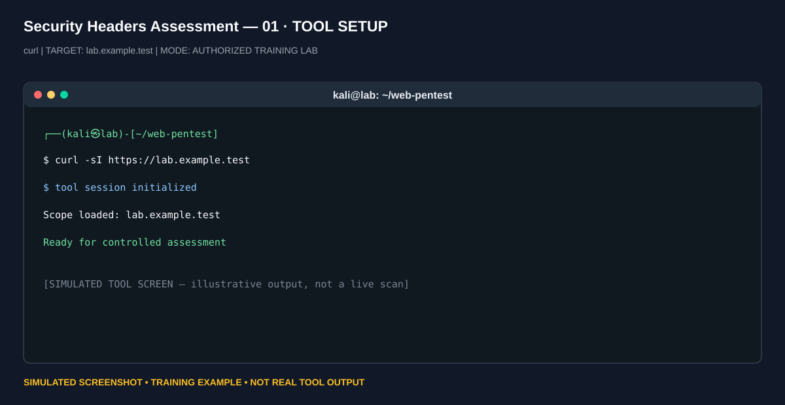
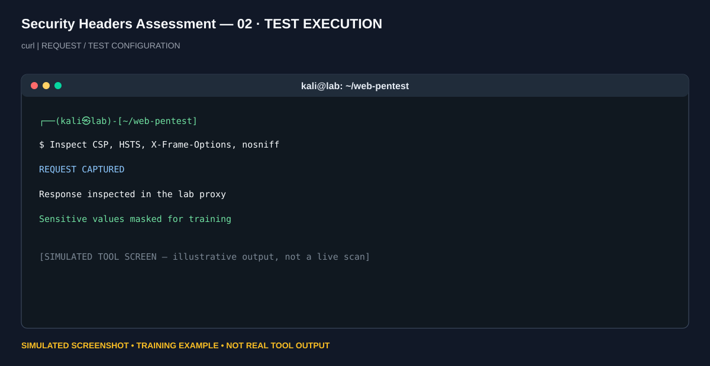
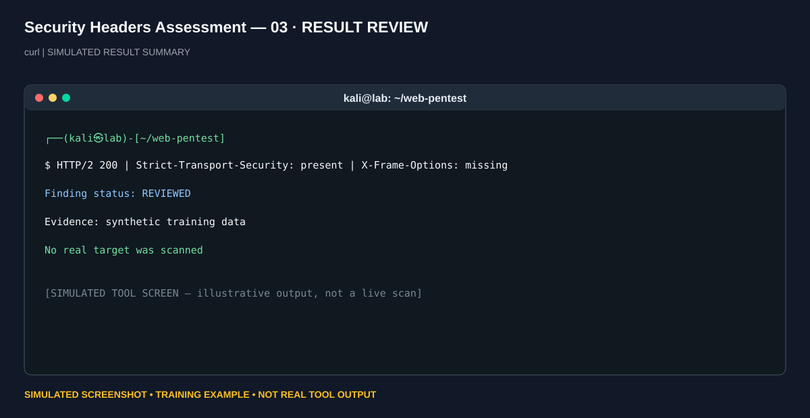

# 03. Security Headers Assessment

**Tier:** Beginner  
**Lab:** Local HTTPS application; Juice Shop can be used for non-TLS headers  
**Tools:** curl, Burp Suite, browser DevTools

## Objective
Review browser security headers and determine whether their configuration matches the application's needs.

## Walkthrough

### 1. Capture headers
~~~bash
curl -sSI http://<LAB_HOST>:<PORT>
~~~
Save the raw response as evidence.

### 2. Review key headers
Check Content-Security-Policy, Strict-Transport-Security, X-Frame-Options or CSP frame-ancestors, X-Content-Type-Options, Referrer-Policy, and Permissions-Policy.

### 3. Compare multiple responses
Capture headers from the home page, login page, and one API endpoint. Note whether configuration differs by route.

### 4. Assess CSP
If present, inspect default-src, script-src, object-src, base-uri, and frame-ancestors. Assess the policy in context; do not label a directive weak without considering the application.

### 5. Assess HTTPS-only controls
HSTS is meaningful only when delivered over HTTPS. Mark it not applicable for a plain HTTP lab rather than reporting a false positive.

### 6. Write the assessment
For each header, record observed value, expected behavior, security purpose, impact, and recommended configuration.

## Screenshots
Illustrative only; replace with real, redacted lab captures.

## Expected output
A header assessment matrix covering the tested routes and actionable configuration recommendations.

## Remediation
Use framework-supported security headers, a carefully tested CSP, HTTPS with HSTS where appropriate, and consistent configuration across application routes.

## Simulated tool screenshots

> These are **simulated tool-interface examples** created for learning. They are not live captures, real scan output, or proof that a vulnerability exists. Values and results are illustrative. Reproduce the workflow in your own authorized lab before reporting a finding.

### Step 1 — Tool setup and initial command

The screen shows the selected tool, the lab target, and the initial command or configuration. Use it as a visual guide when preparing your own test.

### Step 2 — Test execution

This screen illustrates the request, input, or test action. Compare it with the walkthrough instructions and adjust only within your authorized lab scope.

### Step 3 — Result review

This screen illustrates an example result and analyst review. It is not a confirmed finding. Validate actual behavior, preserve your own evidence, and complete the report template.
