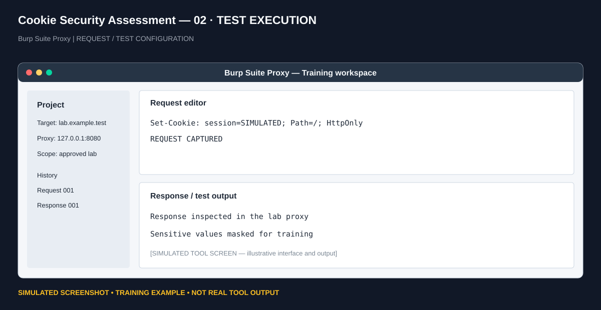
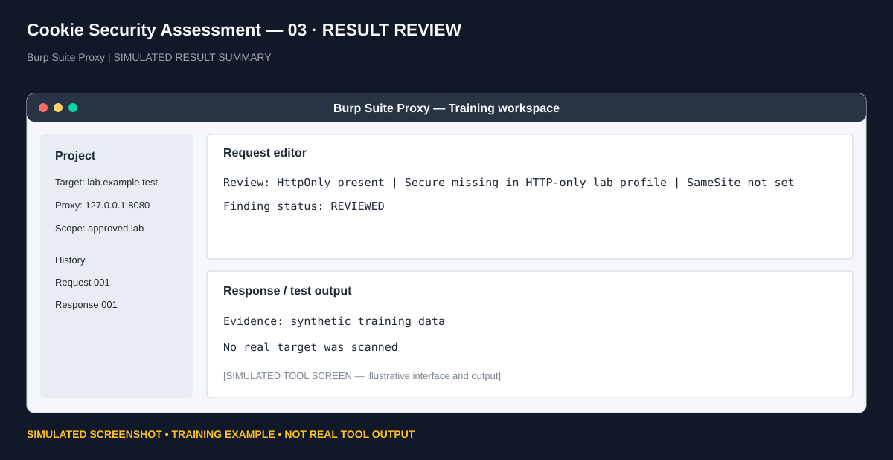

# 04. Cookie Security Assessment

**Tier:** Beginner  
**Lab:** Juice Shop with a dedicated test account  
**Tools:** Browser DevTools, Burp Suite

## Objective
Assess cookie attributes and session lifecycle protections.

## Walkthrough

### 1. Create a test account
Register a disposable lab user and log in. Never use a real password.

### 2. Inspect cookies
In browser DevTools, open Application/Storage → Cookies. Record cookie name, domain, path, expiry, Secure, HttpOnly, and SameSite attributes.

### 3. Capture Set-Cookie
Use Burp HTTP history to inspect the response that sets the authentication cookie. Redact the cookie value before saving evidence.

### 4. Check session rotation
Compare the session identifier before login and after successful authentication. Determine whether authentication changes the identifier.

### 5. Check logout and expiry
Log out, then verify whether the server invalidates the session. Test idle expiry only within the lab and according to the application's policy.

### 6. Document results
Create a cookie matrix and explain the purpose and observed value of each attribute.

## Screenshots
The embedded images are simulated. Replace them with real lab captures and redact cookie values.

## Expected output
A cookie security report covering Secure, HttpOnly, SameSite, scope, rotation, expiry, and logout behavior.

## Remediation
Set Secure for HTTPS cookies, HttpOnly for session cookies, an appropriate SameSite policy, narrow Domain and Path scope, and server-side session invalidation.

## Simulated tool screenshots

> These are **simulated tool-interface examples** created for learning. They are not live captures, real scan output, or proof that a vulnerability exists. Values and results are illustrative. Reproduce the workflow in your own authorized lab before reporting a finding.

### Step 1 — Tool setup and initial command

The screen shows the selected tool, the lab target, and the initial command or configuration. Use it as a visual guide when preparing your own test.

### Step 2 — Test execution

This screen illustrates the request, input, or test action. Compare it with the walkthrough instructions and adjust only within your authorized lab scope.

### Step 3 — Result review

This screen illustrates an example result and analyst review. It is not a confirmed finding. Validate actual behavior, preserve your own evidence, and complete the report template.
