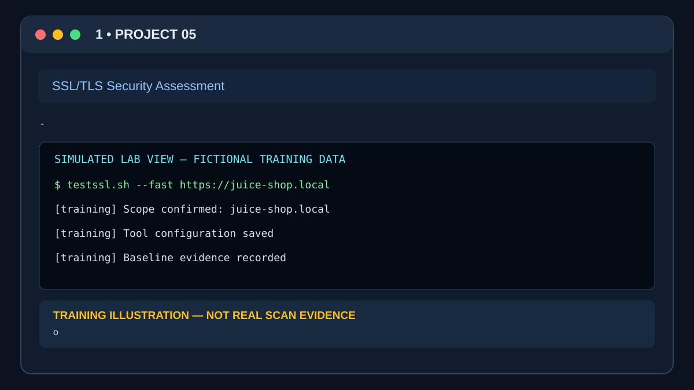
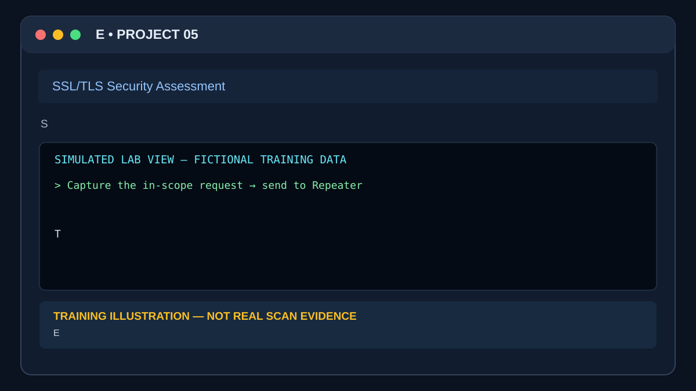
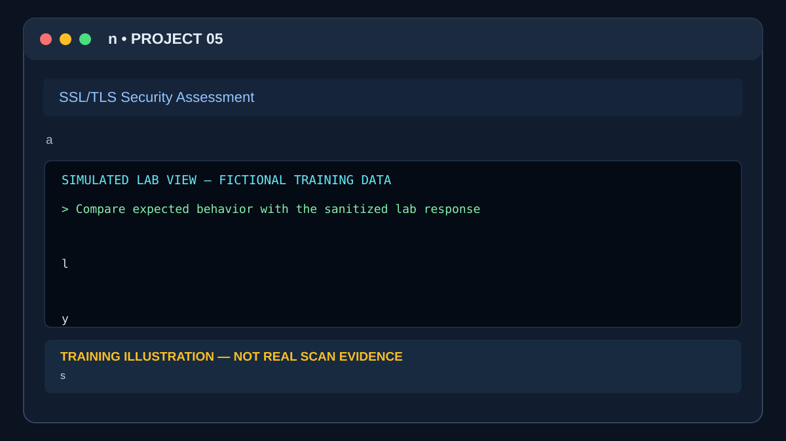

# 05. SSL/TLS Security Assessment

**Tier:** Beginner  
**Lab:** Local HTTPS service with a lab certificate  
**Tools:** OpenSSL, testssl.sh, Nmap

## Objective
Review certificate validity, TLS versions, cipher suites, and server-side TLS configuration.

## Walkthrough

### 1. Confirm HTTPS exists
~~~bash
nmap -sV -p 443 <LAB_HOST>
~~~
A plain HTTP Juice Shop port cannot be used to assess TLS. Configure a local HTTPS service first.

### 2. Inspect the TLS handshake
~~~bash
openssl s_client -connect <LAB_HOST>:443 -servername <LAB_NAME>
~~~
Record negotiated protocol, cipher, and certificate verification details.

### 3. Extract certificate metadata
~~~bash
echo | openssl s_client -connect <LAB_HOST>:443 -servername <LAB_NAME> 2>/dev/null | openssl x509 -noout -subject -issuer -dates
~~~

### 4. Enumerate protocols and ciphers
~~~bash
testssl.sh <LAB_HOST>:443
nmap -p 443 --script ssl-enum-ciphers <LAB_HOST>
~~~

### 5. Review the findings
Check expiry, hostname match, chain, deprecated protocol support, and weak cipher suites. A self-signed certificate in a training lab is not automatically a production finding.

### 6. Write the report
Record target, certificate details, protocols, ciphers, evidence, impact, and remediation.

## Screenshots
Illustrative training images only; replace with genuine lab output.

## Expected output
A TLS configuration assessment with certificate evidence and protocol/cipher observations.

## Project-specific simulated tool screenshots

> The following are fictional training illustrations of the setup, test action, and analyst review. They are not genuine captures, actual scan output, or proof of a vulnerability. Reproduce the workflow in an authorized lab and replace these examples with your own redacted evidence.

