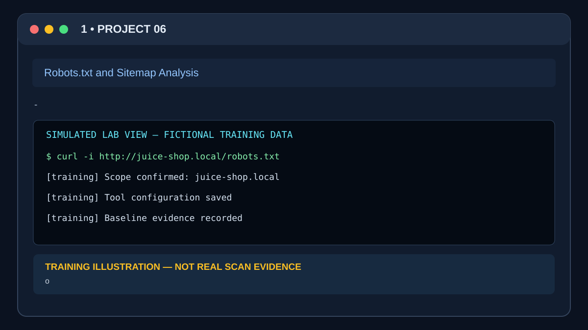
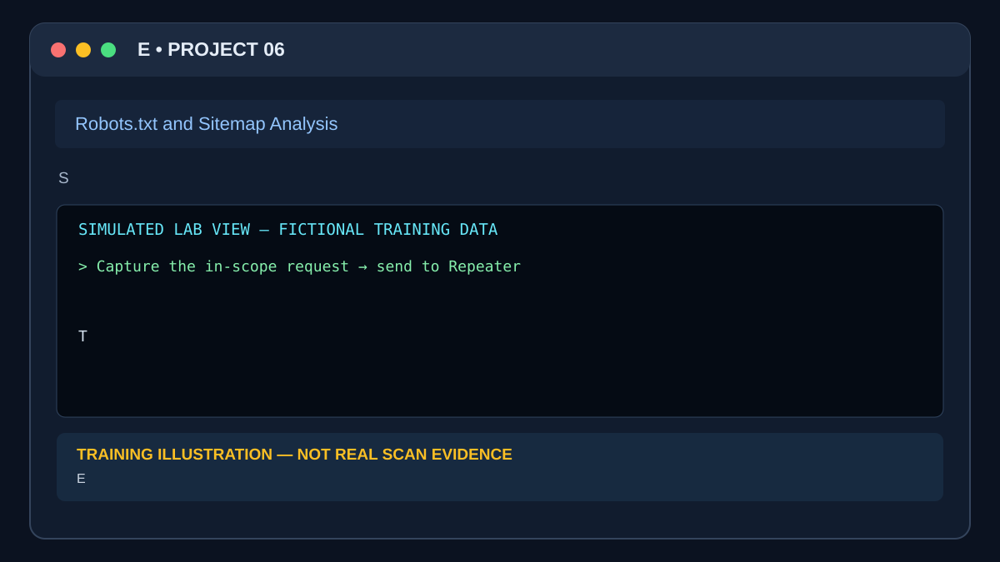
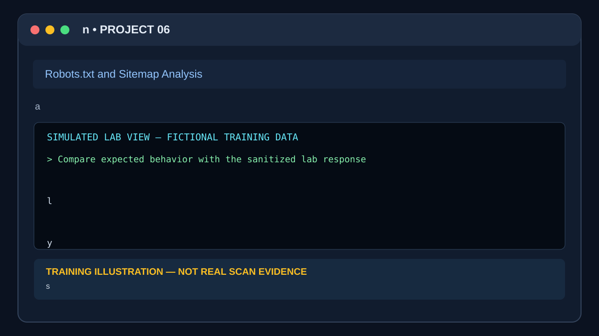

# 06. Robots.txt and Sitemap Analysis

**Tier:** Beginner  
**Lab:** Juice Shop or a local web server with robots.txt and sitemap.xml  
**Tools:** Browser, curl, Burp Suite

## Objective
Review publicly referenced paths and determine whether any resource is unintentionally exposed.

## Walkthrough

### 1. Request discovery files
~~~bash
curl -i http://<LAB_HOST>/robots.txt
curl -i http://<LAB_HOST>/sitemap.xml
~~~

### 2. Extract paths
Record disallowed paths, sitemap URLs, and references to staging, admin, test, or obsolete resources.

### 3. Validate paths individually
Request each discovered path and record status, redirect, content type, and authentication behavior. Do not assume a path is sensitive based on its name.

### 4. Verify exposure
Determine whether a resource actually returns sensitive information or allows an unauthorized action. A robots.txt entry alone is not a vulnerability.

### 5. Document findings
Include the source file, discovered path, observed response, access requirement, and verified impact.

## Screenshots
Simulated illustrations only; replace with your own lab evidence.

## Expected output
A resource discovery report distinguishing ordinary public routes from confirmed information disclosure.

## Project-specific simulated tool screenshots

> The following are fictional training illustrations of the setup, test action, and analyst review. They are not genuine captures, actual scan output, or proof of a vulnerability. Reproduce the workflow in an authorized lab and replace these examples with your own redacted evidence.

