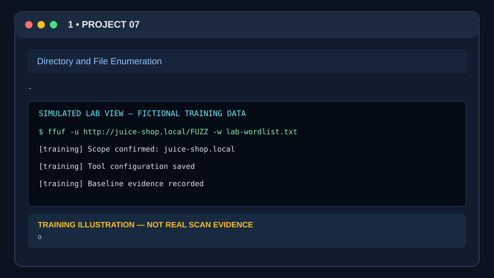
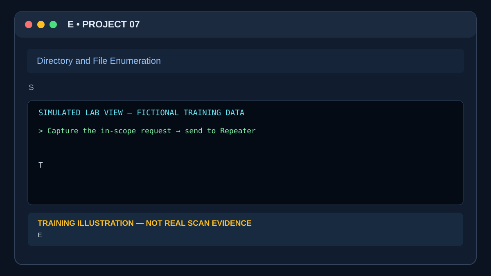
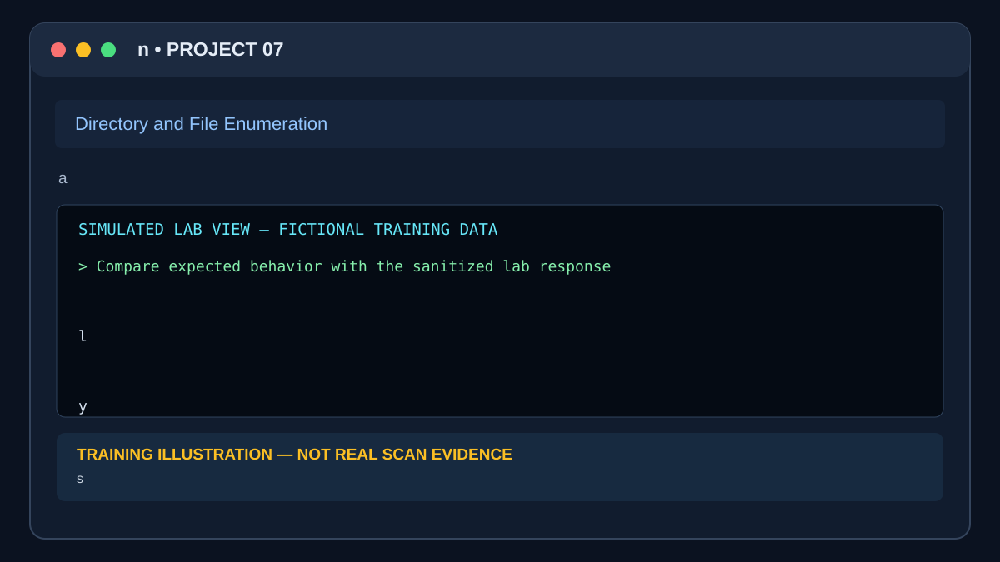

# 07. Directory and File Enumeration

**Tier:** Beginner  
**Lab:** Intentionally vulnerable local web server  
**Tools:** ffuf or Gobuster, Burp Suite, curl

## Objective
Discover web paths and validate whether files or directories are unintentionally exposed.

## Walkthrough

### 1. Define the exact target
Set the lab URL and use a small approved wordlist. Keep the scan limited to one local host.

### 2. Run a low-rate discovery scan
~~~bash
ffuf -u http://<LAB_HOST>/FUZZ -w <WORDLIST> -rate 10
~~~
Alternatively use Gobuster with a conservative thread count.

### 3. Triage results
Group by status code, response size, redirects, and content type. Remove common false positives such as wildcard responses.

### 4. Validate candidates
Manually request each candidate path with curl or Burp. Check whether it is a normal application route, protected resource, backup file, directory index, or sensitive artifact.

### 5. Preserve evidence
Save sanitized output and a short validation note for each meaningful result. Do not download or publish real secrets.

## Screenshots
The images are simulated training examples. Replace them with your own scan and validation screenshots.

## Expected output
An enumeration report listing discovered paths, validation status, and confirmed exposure only.

## Project-specific simulated tool screenshots

> The following are fictional training illustrations of the setup, test action, and analyst review. They are not genuine captures, actual scan output, or proof of a vulnerability. Reproduce the workflow in an authorized lab and replace these examples with your own redacted evidence.

