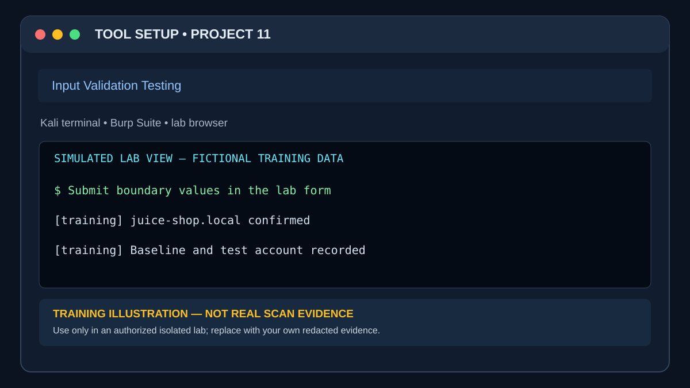
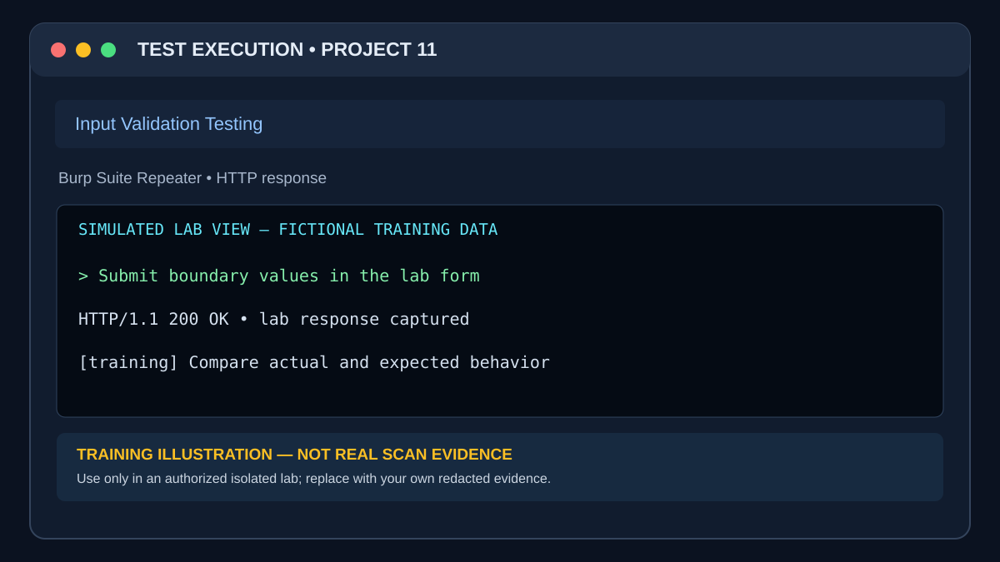
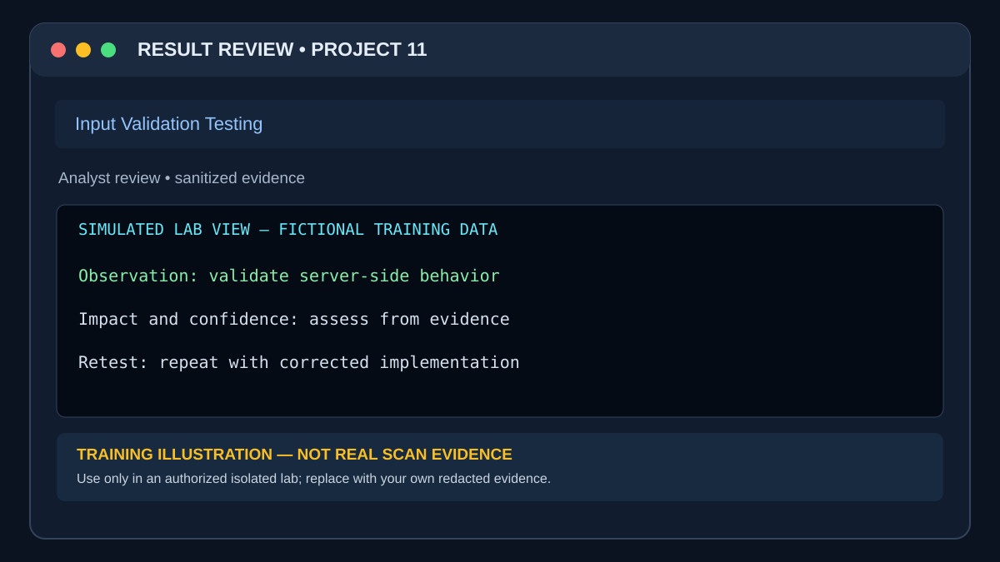

# 11. Input Validation Testing

**Tier:** Beginner  
**Lab:** DVWA or WebGoat  
**Tools:** Burp Suite, OWASP ZAP, browser DevTools

## Objective
Assess whether the application enforces the expected security controls for input validation testing.

## Lab preparation and scope
Deploy the selected application in an isolated VM, Docker network, or localhost environment. Use disposable test accounts and synthetic data. Record target URL, version, date, and tool versions. Never test third-party or production systems without written authorization.

## Baseline
Complete the normal workflow once. Capture the request and response in Burp and note expected behavior before changing requests.

## Step-by-step walkthrough

### Step 1

Inventory form fields, URL parameters, and JSON properties

### Step 2

Capture baseline requests with valid values

### Step 3

Test empty values, boundary lengths, unexpected types, and harmless special characters

### Step 4

Compare client-side checks with server responses and inspect exceptions

### Step 5

Document reproducible validation failures and security impact

## Screenshots and evidence
The images are simulated training illustrations, not real test evidence. Replace them with your own redacted screenshots after running the authorized lab.

Save sanitized request/response examples. Redact credentials, cookies, reset links, tokens, and personal data.

## Analysis and expected output
Compare test behavior with baseline. Validate suspected issues manually and rule out expected application behavior. Record endpoint, test role, input, response, reproducibility, and verified impact.

## Findings and remediation
Use the report template in report/report-template.md. Recommend server-side controls, secure framework defaults, least privilege, and safe handling of user-controlled data as appropriate. Retest after remediation.

## References
- [OWASP Web Security Testing Guide](https://owasp.org/www-project-web-security-testing-guide/)
- [OWASP Cheat Sheet Series](https://cheatsheetseries.owasp.org/)
- [PortSwigger Web Security Academy](https://portswigger.net/web-security)

## Project-specific simulated tool screenshots

> Fictional training illustrations of setup, test execution, and analyst review—not genuine captures, actual scan output, or proof of a vulnerability. Reproduce the workflow in an authorized lab and replace these examples with your own redacted evidence.

