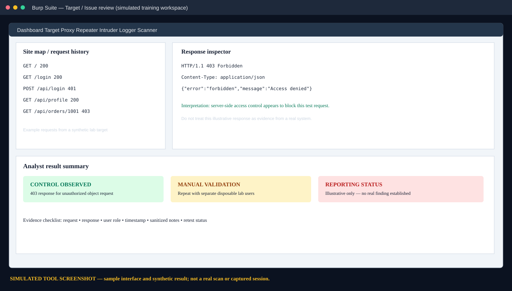

# 15. Basic Access Control Testing

**Tier:** Beginner  
**Lab:** Juice Shop or WebGoat with multiple roles  
**Tools:** Burp Suite, browser DevTools

## Objective
Assess whether the application enforces the expected security controls for basic access control testing.

## Lab preparation and scope
Deploy the selected application in an isolated VM, Docker network, or localhost environment. Use disposable test accounts and synthetic data. Record target URL, version, date, and tool versions. Never test third-party or production systems without written authorization.

## Baseline
Complete the normal workflow once. Capture the request and response in Burp and note expected behavior before changing requests.

## Step-by-step walkthrough

### Step 1

Create two normal users and an admin user if supported

### Step 2

Build a role-to-function matrix from visible navigation and routes

### Step 3

Capture page and action requests for each role

### Step 4

Replay a low-privilege request against a restricted route or object using lab accounts

### Step 5

Confirm server-side authorization and document reproducible unauthorized access

## Screenshots and evidence
The images are simulated training illustrations, not real test evidence. Replace them with your own redacted screenshots after running the authorized lab.

Save sanitized request/response examples. Redact credentials, cookies, reset links, tokens, and personal data.

## Analysis and expected output
Compare test behavior with baseline. Validate suspected issues manually and rule out expected application behavior. Record endpoint, test role, input, response, reproducibility, and verified impact.

## Findings and remediation
Use the report template in report/report-template.md. Recommend server-side controls, secure framework defaults, least privilege, and safe handling of user-controlled data as appropriate. Retest after remediation.

## References
- [OWASP Web Security Testing Guide](https://owasp.org/www-project-web-security-testing-guide/)
- [OWASP Cheat Sheet Series](https://cheatsheetseries.owasp.org/)
- [PortSwigger Web Security Academy](https://portswigger.net/web-security)
