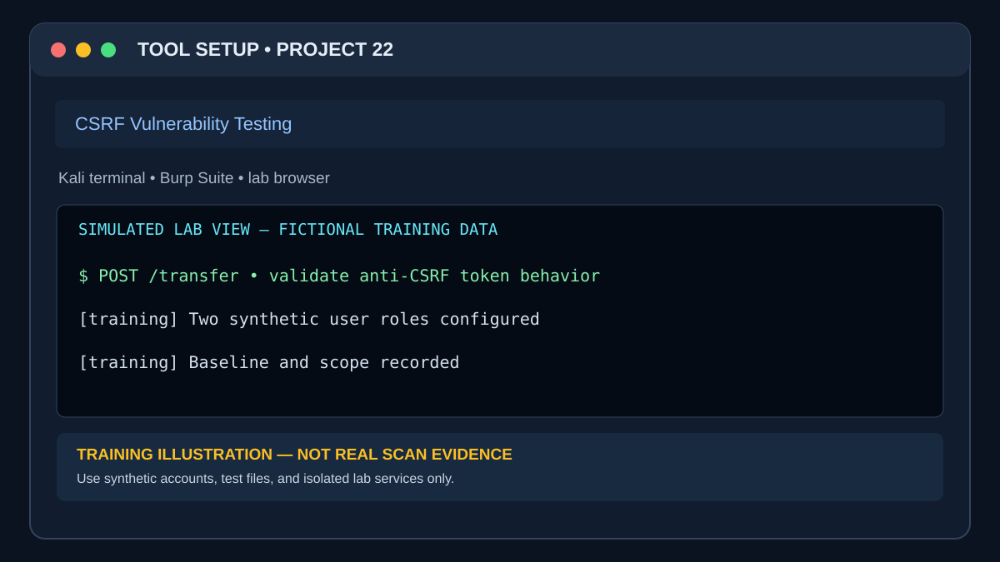
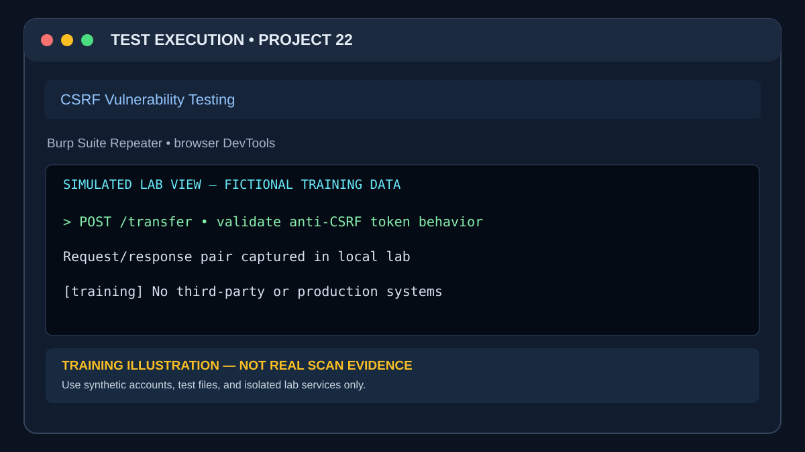
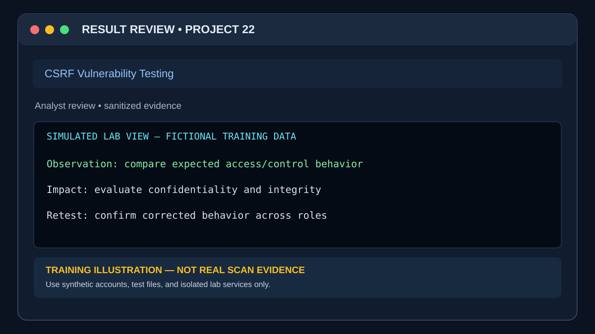

# 22. CSRF Vulnerability Testing

**Tier:** Intermediate  
**Lab:** DVWA or WebGoat state-changing action  
**Tools:** Burp Suite, browser DevTools

## 1. Objective
Validate csrf vulnerability testing in a controlled training application. The purpose is to establish normal behavior, test one security boundary at a time, and preserve reproducible evidence.

## 2. Lab setup and scope
Deploy the selected target in an isolated VM, Docker network, or localhost-only environment. Use disposable accounts and synthetic records. Record the exact target URL, application version, date, and tool versions. Stay within the authorized lab scope.

## 3. Baseline
Complete the normal workflow first. Capture the request and response in Burp, note the expected behavior, and save a sanitized baseline.

## 4. Step-by-step walkthrough

### Step 1

Identify a state-changing action and capture its normal request

### Step 2

Determine whether a unique anti-CSRF token is present and validated

### Step 3

In the lab, compare missing, invalid, and reused token cases

### Step 4

Review SameSite and Origin or Referer validation as defense in depth

### Step 5

Report demonstrated risk and recommend framework CSRF protection

## 5. Screenshots and evidence
The embedded images are simulated training illustrations, not real test evidence. Replace them with your own redacted screenshots after executing the lab.

Preserve the request, response, test account role, timestamp, and relevant application logs. Redact credentials, session identifiers, tokens, and personal data.

## 6. Analysis and expected output
A scanner alert or unexpected response is not sufficient by itself. Reproduce the behavior manually, compare it with baseline, and explain the preconditions and verified confidentiality, integrity, or availability impact. Note false-positive checks and limitations.

## 7. Findings and remediation
Use the report format in [SCREENSHOTS_GUIDE.md](../../SCREENSHOTS_GUIDE.md) as evidence guidance and document a finding only when confirmed. Include root cause, affected endpoint, severity reasoning, remediation, and retest steps.

## 8. References
- [OWASP Web Security Testing Guide](https://owasp.org/www-project-web-security-testing-guide/)
- [OWASP Cheat Sheet Series](https://cheatsheetseries.owasp.org/)
- [PortSwigger Web Security Academy](https://portswigger.net/web-security)

**Safety:** Authorized, isolated training targets only. Do not run these tests against systems without explicit written permission.

## Project-specific simulated tool screenshots

> Fictional training illustrations of setup, test execution, and analyst review—not genuine captures, actual scan output, or proof of a vulnerability. Reproduce the workflow in an authorized lab and replace these examples with your own redacted evidence.

