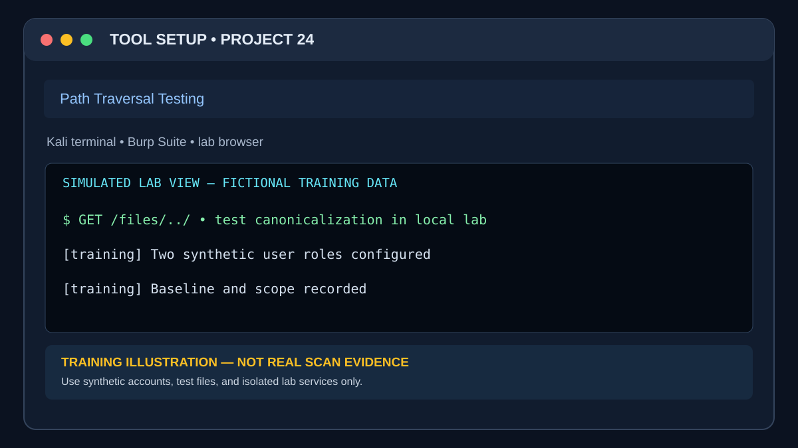
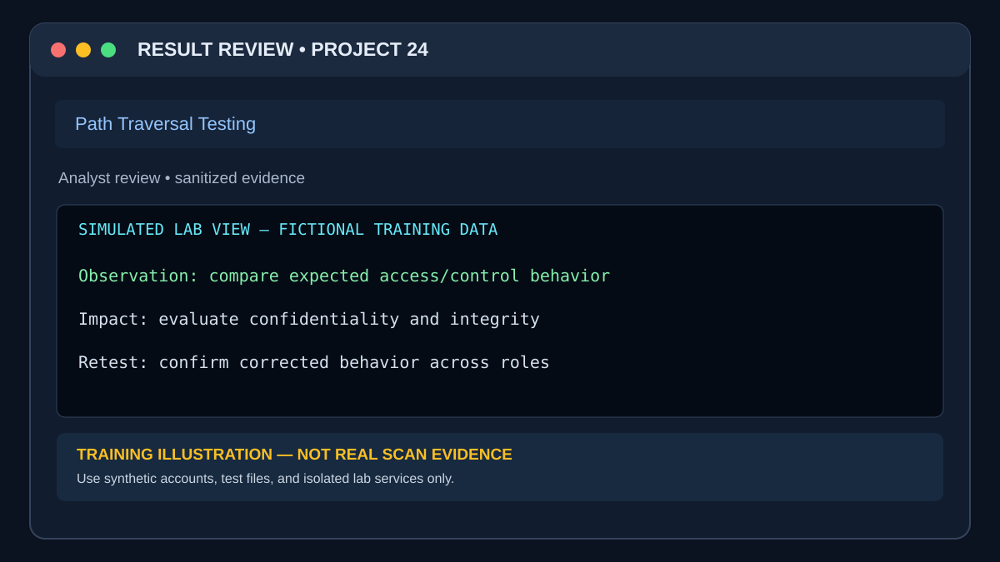

# 24. Path Traversal Testing

**Tier:** Intermediate  
**Lab:** WebGoat or local file lab  
**Tools:** Burp Suite, curl

## Objective
Assess path traversal testing using a repeatable test plan in an isolated training environment.

## Lab setup and scope
Deploy the lab target locally or in a dedicated host-only network. Create disposable test users and synthetic data. Record target, version, date, and tool versions. Only test assets explicitly in scope.

## Baseline
Perform the normal application workflow and capture a representative request and response before modifying any inputs. Redact secrets in saved evidence.

## Step-by-step walkthrough

### Step 1

Identify a file or download parameter that selects a server-side resource

### Step 2

Capture a valid request and determine the lab fixture directory

### Step 3

Use a harmless traversal test against a fixture file created for the exercise; do not target operating-system secrets

### Step 4

Compare encoded and normalized path handling

### Step 5

Document the affected parameter and recommend canonical path resolution and allowlisted file identifiers

## Screenshots and evidence
The images below are simulated training illustrations and are not real test evidence. Replace them with your own redacted lab screenshots after testing.

Preserve the baseline, test request, response, timestamp, test account role, and relevant logs. Never publish passwords, session tokens, API keys, or personal information.

## Expected results and analysis
Compare each test with the baseline. Manually reproduce any suspected issue and document false-positive checks. State exactly what the application did, which security boundary was affected, and what impact was demonstrated. A tool alert alone is not a confirmed finding.

## Findings, remediation, and retest
Document confirmed findings with affected endpoint, prerequisites, severity reasoning, evidence, impact, and root cause. Recommend server-side enforcement and secure defaults appropriate to the weakness. Retest after remediation and record the result.

## References
- [OWASP Web Security Testing Guide](https://owasp.org/www-project-web-security-testing-guide/)
- [OWASP Cheat Sheet Series](https://cheatsheetseries.owasp.org/)
- [PortSwigger Web Security Academy](https://portswigger.net/web-security)

**Safety:** Authorized isolated lab targets only. No testing against systems without explicit written permission.

## Project-specific simulated tool screenshots

> Fictional training illustrations of setup, test execution, and analyst review—not genuine captures, actual scan output, or proof of a vulnerability. Reproduce the workflow in an authorized lab and replace these examples with your own redacted evidence.

